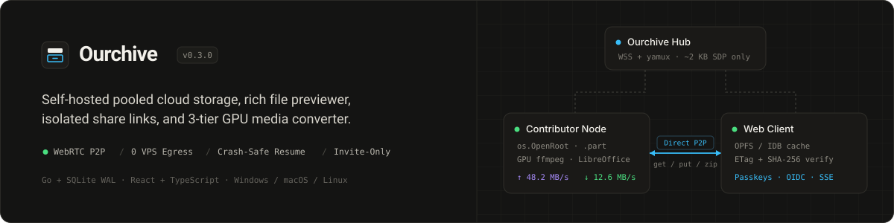
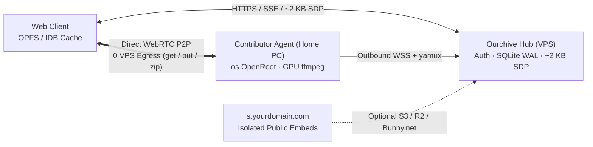

<p align="center">
  
</p>

<p align="center">
  <a href="docs/architecture.md">Architecture</a>
  &nbsp;&middot;&nbsp;
  <a href="docs/deployment.md">Deployment</a>
  &nbsp;&middot;&nbsp;
  <a href="docs/agent.md">Contributor Agent</a>
  &nbsp;&middot;&nbsp;
  <a href="docs/converter.md">Media &amp; Doc Converter</a>
  &nbsp;&middot;&nbsp;
  <a href="docs/security.md">Security Model</a>
</p>

---

**Ourchive** is a self-hosted, invite-only platform that lets a private group pool storage and GPU compute from their own Windows, macOS, and Linux machines behind home NAT.

A single small VPS runs the **Hub** control plane (auth, search, permissions, thumbnails, WebRTC signaling, and isolated share links), while bulk downloads, uploads, and `.zip` exports stream **directly peer-to-peer** between browsers and contributor machines—keeping VPS egress near zero.

---

## Core Capabilities

| Area | What Ourchive Provides |
| :--- | :--- |
| **Egress-Safe P2P Storage** | Direct WebRTC DataChannels (`get`, `put`, streaming `.zip`) between browser and contributor machines with automatic HTTP Range/ETag fallback behind strict NAT |
| **Crash-Safe Transfers** | Browser **OPFS / IndexedDB** download staging and `.ourchive.part` atomic uploads with ETag validation and SHA-256 verification that survive dropped Wi-Fi or power loss |
| **Owner-Sovereign Agent** | Single-binary cross-platform daemon (`Windows`, `macOS`, `Linux`) with `os.OpenRoot` jailing, `--read-only` / `--allow-dir` guards, multi-hub configs, logon service, and signed auto-updates |
| **Rich Previewer & Share Links** | Hub-cached WebP thumbnails (browse even when nodes are offline), global search, rename/multi-select, and an isolated `s.yourdomain.com` subdomain for Discord/web embeds |
| **3-Tier Media & Doc Converter** | Full `vert.sh`-parity video/audio/image conversion via discrete GPU `ffmpeg`, plus LibreOffice/Pandoc/pure-Go and browser-local conversion for PDF, DOCX, ODT, EPUB, RTF, CSV, JSON, XML, YAML |
| **Invite-Only Auth & ACLs** | Argon2id + invite lineage tree, **Passkeys (WebAuthn + Signal API)**, **OpenID Connect (OIDC PKCE)**, per-mount group ACLs, real-time SSE, and tiered audit logs |

---

## How Transfers Avoid VPS Egress



Because the VPS only coordinates metadata, thumbnails, and ~2 KB WebRTC handshakes, a **2 vCPU / 2 GB RAM** micro-VPS comfortably supports **100+ users**. See [docs/architecture.md](docs/architecture.md) and [docs/deployment.md](docs/deployment.md) for sizing details.

---

## Quickstart

### 1. Local Development (Windows)
```powershell
.\dev.ps1 -Agent
```
- Hub API & static UI: `http://localhost:8080`
- Vite dev server (HMR): `http://localhost:5173`
- Isolated share subdomain: `http://s.localhost:8080/<slug>`

### 2. Production VPS (Docker Compose + Caddy)
Point `archive.yourdomain.com` and `s.yourdomain.com` to your VPS, then:

```bash
cp .env.example .env
# Set OURCHIVE_APP_DOMAIN and OURCHIVE_SHARE_DOMAIN in .env
docker compose up -d --build
```

Caddy automatically provisions Let's Encrypt HTTPS certificates. Your SQLite database (`./data/ourchive.db`) and thumbnail cache (`./data/thumbs/`) persist on the host across updates:

```bash
git pull && docker compose up -d --build
```

For bare-metal Linux (`systemd` + Caddy), environment variables, backups, and S3/R2/Bunny.net Edge Storage, see [docs/deployment.md](docs/deployment.md).

### 3. Connect a Contributor Machine (No Go Required)
On a desktop or laptop, install the **Ourchive app** ([docs/client.md](docs/client.md)): it runs in the tray, contributes the computer without a console window, and the hub's *Connect a machine* dialog can hand it an enrollment with one click. For servers and NAS boxes, use the headless agent below.

Generate an enrollment token in **Contribution settings → Connect a machine**, then replace `OWNER/REPO`, `HUB`, and `TOKEN`:

**Windows (PowerShell):**
```powershell
$repo="OWNER/REPO"; $hub="https://archive.yourdomain.com"; $tok="TOKEN"; Stop-Process -Name ourchive-agent -Force -ErrorAction SilentlyContinue; $dir="$env:LOCALAPPDATA\Ourchive"; New-Item -ItemType Directory -Force $dir | Out-Null; $exe="$dir\ourchive-agent.exe"; Invoke-WebRequest "https://github.com/$repo/releases/latest/download/ourchive-agent-windows-amd64.exe" -OutFile $exe; & $exe enroll --hub $hub --token $tok; & $exe update --url "https://api.github.com/repos/$repo/releases/latest" --enable-auto; & $exe service install; Start-Process $exe -ArgumentList "run" -WindowStyle Hidden
```

**macOS / Linux (Bash):**
```bash
REPO="OWNER/REPO" HUB="https://archive.yourdomain.com" TOK="TOKEN" bash -c '
  OS=$(uname -s | tr "[:upper:]" "[:lower:]")
  ARCH=$(uname -m | sed -e "s/x86_64/amd64/" -e "s/aarch64/arm64/")
  DIR="$HOME/.local/bin"; mkdir -p "$DIR"; BIN="$DIR/ourchive-agent"
  curl -fsSL "https://github.com/$REPO/releases/latest/download/ourchive-agent-$OS-$ARCH" -o "$BIN"
  chmod +x "$BIN"
  "$BIN" enroll --hub "$HUB" --token "$TOK"
  "$BIN" update --url "https://api.github.com/repos/$REPO/releases/latest" --enable-auto
  "$BIN" service install
'
```

Add `--read-only` to `enroll` to enforce local read-only protection on the contributor machine. Full CLI reference in [docs/agent.md](docs/agent.md).

---

## Documentation

| Guide | Contents |
| :--- | :--- |
| [Architecture](docs/architecture.md) | Topology, `WSS + yamux` control plane, WebRTC P2P DataChannels, OPFS/IDB & `.ourchive.part` crash-safe transfers, SSE, migrations |
| [Deployment](docs/deployment.md) | VPS sizing, DNS, Docker Compose + Caddy, bare-metal `systemd`, environment variables, backups, Edge Storage, relay guardrails |
| [Desktop App](docs/client.md) | Native client for Windows/macOS/Linux (members-only on mobile), tray + embedded agent, one UI shared with the website, browser sign-in handoff, building |
| [Contributor Agent](docs/agent.md) | Windows/macOS/Linux installation, CLI flags, multi-hub configs, `os.OpenRoot` confinement, logon service, signed auto-updates |
| [Media & Doc Converter](docs/converter.md) | 3-tier routing, GPU hardware detection (AMD/NVIDIA/Intel/Apple), full `vert.sh`-parity + document format matrix |
| [Security Model](docs/security.md) | Owner sovereignty invariants, Argon2id + invites, Passkeys (WebAuthn + Signal API), OIDC PKCE, per-mount group ACLs, audit logs |

---

## Project Layout

```text
ourchive/
├── cmd/
│   ├── hub/                        # Control-plane HTTP server & router modules
│   │   ├── main.go                 # Startup, hubApp wiring, middleware, SPA/share routing
│   │   ├── routes_auth.go          # Auth, Passkeys (WebAuthn), OIDC, invites, users/groups, audit
│   │   ├── routes_nodes.go         # Nodes, mounts, per-mount ACLs, parity sync, agent tunnel
│   │   ├── routes_vfs.go           # VFS proxy, WebP thumbnails, tags, WebRTC SDP signaling
│   │   ├── routes_shares.go        # Share links API & sticky broadcasts
│   │   ├── routes_compute.go       # 3-tier converter GPU compute proxy & job history
│   │   ├── routes_client.go        # Desktop-app browser sign-in handoff (PKCE one-time codes)
│   │   └── routes_system.go        # SSE stream (/api/events), health, Hub policy & settings
│   └── agent/
│       └── main.go                 # Headless CLI over internal/agentcore (enroll, run, service, update)
├── client/                         # Desktop app (separate Go module, Wails v3): window, tray, deep links
├── internal/
│   ├── agentcore/                  # Agent engine: enroll, WSS+yamux tunnel, multi-hub Runner, instance lock
│   ├── agentlog/                   # Per-user log file for the agent and the app
│   ├── agentstatus/                # Live per-hub connection state for the CLI, tray and UI
│   ├── audit/                      # Tiered audit logging
│   ├── auth/                       # Sessions, Argon2id, invites, ACLs, WebAuthn, OIDC
│   ├── clientcore/                 # Desktop app backend: hub proxy, saved hubs/sessions, /_client bridge
│   ├── compute/                    # Hardware-accelerated ffmpeg + document/data converter
│   ├── db/                         # SQLite WAL loader & embedded migrations (001–009)
│   ├── events/                     # Real-time SSE pub/sub broker
│   ├── handoff/                    # One-time PKCE codes for the app's browser sign-in
│   ├── service/                    # Zero-UAC logon service installer (Win/macOS/Linux)
│   ├── settings/                   # Hub policy, relay caps, OIDC & Edge Storage config
│   ├── shares/                     # Share links & isolated s. subdomain OpenGraph embeds
│   ├── storage/                    # Optional S3 / Cloudflare R2 / Bunny.net edge offload
│   ├── tunnel/                     # Ed25519-authenticated WSS + yamux tunnel broker
│   ├── updater/                    # SHA-256 + Ed25519 verified binary self-updater
│   └── vfs/                        # os.OpenRoot VFS, WebRTC P2P DataChannels, zip, thumbs, tags
├── pkg/protocol/                   # Shared Hub <-> Agent wire structs
├── web/src/                        # React 19 + TypeScript + Vite frontend
│   ├── api.ts, p2p.ts, passkeys.ts, transferCache.ts, converter.ts
│   ├── platform.ts                 # The only web-vs-app difference (isClient, hubOrigin, bridge)
│   ├── components/                 # Explorer, Converter, Previewer, Shares, Admin, Dev Console
│   └── styles/                     # Warm Paper + Graphite tokens & layout styles
├── deploy/                         # Caddyfile & systemd unit for bare-metal Linux
├── scripts/                        # Cross-platform Agent release build scripts
└── docs/                           # Product documentation & architectural assets
```

---

## Building & Testing

```bash
# Run all Go unit & integration tests (auth, ACLs, VFS resume, converter, shares, tunnel, updater)
go test -v ./...

# Build Hub and Agent binaries
go build ./...

# Type-check and build the Web UI
npm --prefix web run build

# Desktop app (see docs/client.md for prerequisites)
(cd client && wails3 task build)
```

Cross-platform Agent release binaries:
- **Windows**: `.\scripts\build-agent.ps1 -Version v0.3.0`
- **macOS / Linux**: `./scripts/build-agent.sh v0.3.0`
- **GitHub Releases**: `git tag v0.3.0 && git push --tags` triggers [.github/workflows/release-agent.yml](.github/workflows/release-agent.yml).
