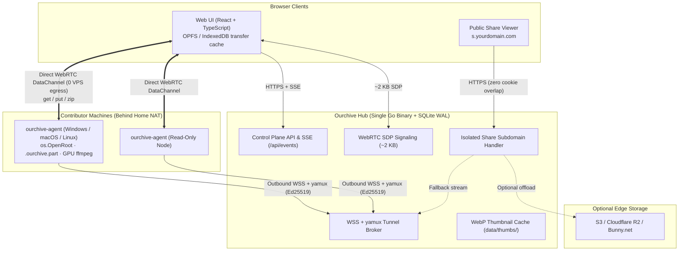

# Architecture

Ourchive splits **control** from **data** so a small VPS can coordinate dozens of contributor machines and over a hundred users without paying for bulk file egress.

---

## System Topology

---

## Components

### 1. Ourchive Hub (`cmd/hub/`)
A single Go binary serving both the API and the compiled React frontend (`OURCHIVE_WEB_DIR`, default `web/dist`).

- **SQLite WAL database** (`internal/db/`): Auto-migrates schemas `001` through `009` on startup with zero external database dependencies.
- **Tunnel Broker** (`internal/tunnel/`): Accepts outbound WebSocket connections from contributor Agents, authenticates them with Ed25519 signatures, and multiplexes HTTP control/fallback requests over `yamux`.
- **WebRTC Signaling**: Relays ~2 KB SDP offers/answers between browser and Agent so bulk file transfers bypass the VPS entirely.
- **Real-Time SSE Bus** (`internal/events/`): Pushes `nodes.updated` (2.5 s heartbeat while clients are connected), `announcements.updated`, `shares.updated`, and `acls.updated` over `GET /api/events`.
- **Isolated Share Subdomain** (`internal/shares/`): Serves public share links, raw media streams, and Discord/Slack OpenGraph embeds on `s.yourdomain.com` with strict cookie isolation from the main app domain.

### 2. Contributor Agent (`cmd/agent/`)
A lightweight, headless cross-platform daemon (Windows, macOS, Linux) that connects outbound through home NAT with zero port forwarding.

- **Filesystem Confinement** (`internal/vfs/`): Every mounted folder is opened through Go's `os.OpenRoot`, blocking symlink escapes and directory traversal at the OS layer.
- **P2P DataChannel Server** (`internal/vfs/p2p.go`): Powered by `pion/webrtc/v4`. Supports `action: "get"` (resumable with byte `offset` and `if_match` ETag), `action: "put"` (crash-safe `.ourchive.part` staging + SHA-256 verification + atomic rename), and `action: "zip"` (on-the-fly streaming `.zip` for folders or multi-select paths).
- **Compute Runner** (`internal/compute/`): Detects discrete GPUs (AMD AMF/VAAPI, NVIDIA NVENC, Intel QSV, Apple VideoToolbox) and executes `ffmpeg` media conversions plus LibreOffice/Pandoc/pure-Go document conversions.
- **Multi-Hub Isolation**: Stores one JSON config per Hub under `$HOME/.config/ourchive/hubs/<hub>.json`.

The engine lives in `internal/agentcore` (enrollment, tunnel, and a `Runner` that keeps every hub connected and publishes per-hub state through `internal/agentstatus`). `cmd/agent` is a thin CLI over it, and the desktop app embeds the same `Runner`. A per-user lock (`~/.config/ourchive/agent.lock`) keeps the two from both contributing the same machine.

### 3. Web Client (`web/src/`)
A React 19 + TypeScript + Vite single-page application, built two ways from one codebase: served by the Hub (`npm run build`) and bundled into the desktop app (`npm run build:client`). `web/src/platform.ts` holds every difference between the two.

- **Transfer Engine** (`web/src/p2p.ts`, `web/src/transferCache.ts`): Attempts direct WebRTC P2P first for downloads, uploads, and `.zip` archives; falls back to Hub HTTP relay (subject to Host Admin relay guardrails) only if strict corporate/symmetric NAT blocks direct ICE candidates.
- **Local Converter** (`web/src/converter.ts`): Runs pure-TypeScript and Canvas conversions directly in the browser when no Agent compute node is available.

---

### 4. Desktop App (`client/`, `internal/clientcore/`)
A Wails v3 native shell around the bundled web UI, with the contributor agent in the same process. `internal/clientcore` reverse-proxies the UI's `/api` calls to the active hub with that hub's stored session, and serves a small `/_client` bridge for hub switching, browser sign-in (`internal/handoff`, PKCE), native downloads and agent control. See [client.md](client.md).

---

## Crash-Safe Transfer Lifecycle

Ourchive transfers are engineered to survive dropped Wi-Fi, closed browser tabs, and sudden power loss on either end.

### Downloads (Browser OPFS / IndexedDB Cache)
1. **Persistent Disk Staging**: Incoming P2P chunks are flushed in 1 MB batches to the browser's **Origin Private File System (OPFS)** (with automatic **IndexedDB** fallback if OPFS is unavailable), keyed by `nodeId + mountId + path`.
2. **Automatic Retry & Resume**: If the DataChannel drops mid-transfer, the client retries up to 3 times with backoff, sending `{ action: "get", offset: bytesReceived, if_match: expectedEtag }`.
3. **Power-Loss Recovery**: If the tab or machine dies before completion, the partial file remains on disk. On the next visit to Explorer, an **"Interrupted downloads saved on disk"** banner offers **Resume** (validating the strong `ETag` and fetching only remaining bytes) or **Discard**.
4. **HTTP Fallback Resume**: Native browser downloads over HTTP receive `Accept-Ranges: bytes` and strong `ETag` headers (`"<size>-<mtime_ns>"`), enabling built-in browser resume in Chromium/Helium/Edge/Firefox.

### Uploads (`.ourchive.part` Atomic Staging)
1. **Hidden Staging File**: Uploads write into `<filename>.ourchive.part` inside the mount's `os.Root`. Partial files are hidden from directory listings, search results, and `.zip` exports.
2. **Resume Negotiation**: On reconnect, the client sends `resume: true`. The Agent returns the exact byte offset already flushed to `.ourchive.part`, and the client continues from that offset.
3. **Integrity & Atomic Swap**: When the final chunk arrives, the Agent verifies the optional SHA-256 digest, calls `f.Sync()` to flush OS buffers, and atomically renames `<filename>.ourchive.part` to `<filename>`. A partially uploaded file never corrupts or overwrites an existing file.

---

## Database Migrations

SQLite runs in WAL mode with automatic forward-only migrations embedded in `internal/db/migrations/`:

| Migration | Purpose |
| :--- | :--- |
| `001_init.sql` | Core users, sessions, groups, and memberships |
| `002_phase1_nodes.sql` | Enrolled contributor nodes, Ed25519 keys, and enrollment tokens |
| `003_phase4_shares.sql` | Share links, slugs, expiration, view limits, and passwords |
| `004_file_pointers_and_single_file_mounts.sql` | Fast-hash relocation pointers and single-file mounts |
| `005_hub_settings.sql` | Host Admin policy, relay guardrails, and Edge Storage config |
| `006_opt_in_sync.sql` | Dual-consent parity sync subscriptions |
| `007_invites_and_audit.sql` | Invite keys, inviter lineage tree, and tiered audit logs |
| `008_announcements.sql` | Sticky banners and Admin broadcasts |
| `009_acls_and_auth.sql` | `mount_group_acls`, `webauthn_credentials`, and `oidc_links` |
